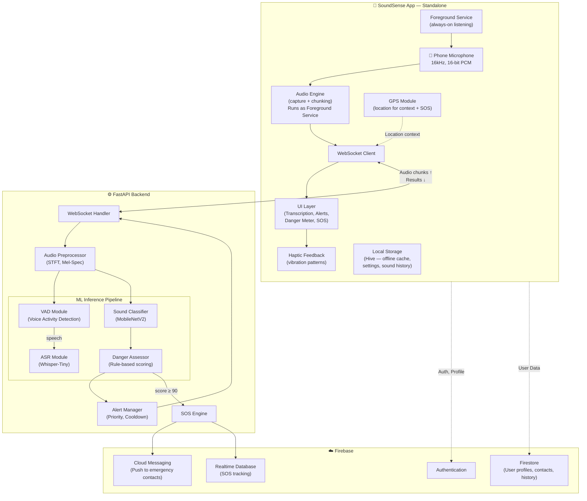
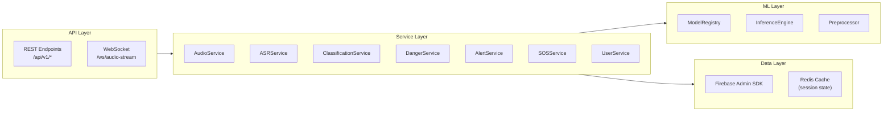
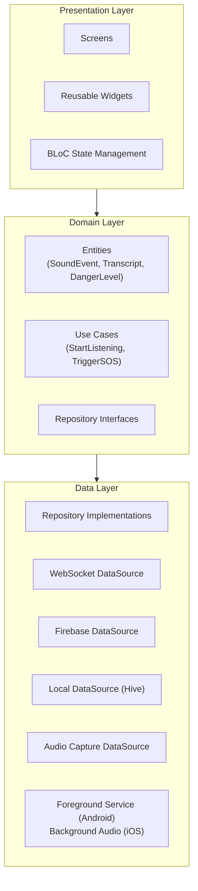
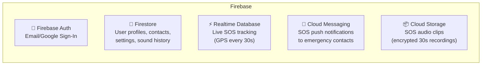
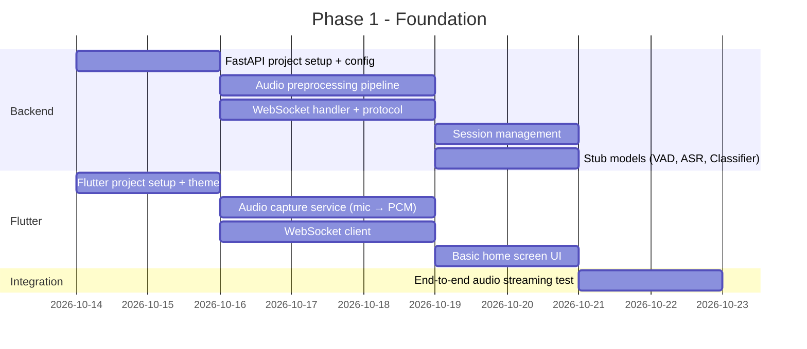

# 🔊 SoundSense — Application Architecture Plan

> **Standalone mobile app** — a real-time assistive system for deaf and hard-of-hearing individuals.  
> Based on the research paper: *"SoundSense: A Wearable Smartwatch-Based Assistive System for Real-Time Environmental Sound Awareness, Spatial Audio Localization, and Safety Assessment"*  
> **Adapted for smartphone deployment** — the phone IS the SoundSense device.

---

## 📋 Table of Contents

1. [System Overview](#1-system-overview)
2. [High-Level Architecture](#2-high-level-architecture)
3. [Backend Architecture (FastAPI)](#3-backend-architecture-fastapi)
4. [Mobile App Architecture (Flutter)](#4-mobile-app-architecture-flutter)
5. [ML Model Integration Strategy](#5-ml-model-integration-strategy)
6. [Database & Firebase Design](#6-database--firebase-design)
7. [API Contracts & Protocols](#7-api-contracts--protocols)
8. [Project Folder Structure](#8-project-folder-structure)
9. [Implementation Roadmap](#9-implementation-roadmap)
10. [Key Design Decisions](#10-key-design-decisions)

---

## 1. System Overview

### What We're Building

A **standalone mobile app** (Android/iOS via Flutter) that turns the user's smartphone into a complete SoundSense device. The phone's built-in microphone captures ambient audio in real-time, streams it to a **FastAPI backend** for ML inference (ASR, sound classification, danger assessment), and presents results through a rich visual interface + haptic feedback. The app runs as a **foreground service**, always listening and alerting — no smartwatch or companion device required.

### Tech Stack Summary

| Layer | Technology | Rationale |
|-------|-----------|----------|
| **Mobile App** | Flutter (Dart) | Superior native audio/haptic support, cross-platform, single codebase |
| **Backend** | Python FastAPI | Best ML ecosystem (PyTorch, TensorFlow), async WebSocket support |
| **Database/Auth** | Firebase | Real-time DB for SOS tracking, FCM for push notifications, easy auth |
| **ML Inference** | Cloud-based (FastAPI server) | Models run on server GPU/CPU, phone streams audio |
| **Communication** | WebSocket (audio stream) + REST (config/SOS) | Low-latency bidirectional streaming |

### Architecture Philosophy

```
┌─────────────────────────────────────────────────────────────────┐
│                     CORE PRINCIPLE                              │
│                                                                 │
│  📱 Phone = THE SoundSense Device                               │
│  (Microphone, GPS, Haptics, Display — all in one)               │
│                                                                 │
│  ⚙️  Server = ML Brain (audio in → insights out)                │
│  (ASR, Sound Classification, Danger Scoring)                    │
│                                                                 │
│  ☁️  Firebase = Memory + Messenger                               │
│  (User data, SOS alerts, Push notifications to contacts)        │
│                                                                 │
│  No smartwatch. No companion device. Just the phone + server.   │
└─────────────────────────────────────────────────────────────────┘
```

---

## 2. High-Level Architecture



> [!NOTE]
> The phone is the **only device**. No smartwatch, no companion clip-on mic. The phone's built-in microphone handles all audio capture. Direction-of-arrival is limited to basic left/right estimation using stereo mics (if available) — the focus for this version is **sound classification, transcription, and danger assessment**.

---

## 3. Backend Architecture (FastAPI)

### 3.1 Layered Architecture



### 3.2 WebSocket Audio Streaming Protocol

This is the **core communication channel** between the phone and the server. The phone continuously streams audio chunks, and the server sends back inference results.

```
┌──────────────┐                          ┌──────────────┐
│  Flutter App  │                          │ FastAPI Server│
└──────┬───────┘                          └──────┬───────┘
       │                                          │
       │──── WS Connect /ws/audio-stream ────────>│
       │<─── { "type": "connected",               │
       │       "session_id": "abc123" } ──────────│
       │                                          │
       │──── { "type": "audio_chunk",             │
       │       "data": "<base64 PCM>",            │
       │       "seq": 1,                          │
       │       "timestamp": 1697... } ───────────>│
       │                                          │
       │                          [Server processes]
       │                          [VAD → ASR / Classify]
       │                                          │
       │<─── { "type": "transcription",           │
       │       "text": "Hello, how are you?",     │
       │       "speaker": 1,                      │
       │       "confidence": 0.92,                │
       │       "is_final": false } ───────────────│
       │                                          │
       │<─── { "type": "sound_event",             │
       │       "class": "car_horn",               │
       │       "confidence": 0.87,                │
       │       "priority": "P1",                  │
       │       "danger_score": 62,                │
       │       "danger_level": "CAUTION" } ───────│
       │                                          │
       │──── { "type": "location_update",         │
       │       "lat": 28.61, "lng": 77.23 } ─────>│
       │                                          │
```

### 3.3 Key Backend Services

#### `AudioService` — Audio Preprocessing Pipeline
```python
# Responsibilities:
# 1. Receive raw PCM audio chunks from WebSocket
# 2. Assemble into processing windows (960ms for classification, 500ms for ASR)
# 3. Apply preprocessing: high-pass filter (80Hz), AGC, STFT, log-mel spectrogram
# 4. Compute RMS amplitude per frame → dB SPL
# 5. Feed preprocessed features to downstream ML services
```

#### `ASRService` — Speech-to-Text
```python
# Responsibilities:
# 1. Receive VAD-gated audio segments (only when speech is detected)
# 2. Run Whisper-Tiny inference on 500ms chunks with 250ms overlap
# 3. Maintain KV-cache across chunks for contextual coherence
# 4. Speaker diarization via ECAPA-TDNN embeddings + online clustering
# 5. Return incremental transcription results (partial + final)
```

#### `ClassificationService` — Environmental Sound Detection
```python
# Responsibilities:
# 1. Run MobileNetV2 classifier on 960ms log-mel spectrogram windows
# 2. Return top-k predictions with confidence scores
# 3. Map predictions to priority levels (P0-P3)
# 4. Apply per-class cooldown (5s) to prevent alert fatigue
```

#### `DangerService` — Multi-Factor Danger Assessment
```python
# Responsibilities:
# 1. Compute composite danger score D from 5 factors:
#    D = 0.35*S_type + 0.25*S_intensity + 0.20*S_proximity + 0.10*S_approach + 0.10*S_context
# 2. Classify into danger levels: Safe (0-25), Aware (26-50), Caution (51-75), Danger (76-100)
# 3. Apply hysteresis (5-point threshold for 3 consecutive seconds)
# 4. Track cumulative noise exposure (NIOSH REL)
# 5. Trigger SOS engine when D ≥ 90 for 5+ seconds
```

#### `SOSService` — Emergency Response
```python
# Responsibilities:
# 1. Handle manual SOS triggers (from app button)
# 2. Handle automatic triggers (danger score, fall detection)
# 3. Compile SOS payload (user info, GPS, environment snapshot, 30s audio clip)
# 4. Send to emergency contacts via Firebase Cloud Messaging
# 5. Enter 30-min tracking mode (GPS updates every 30s)
# 6. 10-second cancellation countdown for auto-triggers
```

#### `AlertService` — Alert Management
```python
# Responsibilities:
# 1. Priority-based alert queuing (P0 > P1 > P2 > P3)
# 2. Per-class cooldown management (5s window)
# 3. Cooldown override: confidence increase >15% or proximity zone change
# 4. Rate limiting to prevent alert fatigue
# 5. Format alert payloads for the Flutter app
```

### 3.4 Session Management

Each connected client gets a **session** that tracks:

```python
class AudioSession:
    session_id: str
    user_id: str
    
    # Audio state
    audio_buffer: RingBuffer       # Rolling audio buffer
    current_db_spl: float          # Current dB SPL reading
    
    # ASR state
    is_speech_active: bool
    kv_cache: dict                 # Whisper KV-cache for streaming
    speaker_embeddings: list       # For diarization clustering
    speaker_map: dict              # cluster_id → speaker_label
    
    # Classification state
    last_alerts: dict              # {sound_class: timestamp} for cooldown
    proximity_history: list        # For approach rate detection (5s window)
    
    # Danger state
    danger_score_history: list     # For hysteresis (3s window)
    cumulative_noise_dose: float   # NIOSH noise dose tracking
    
    # SOS state
    sos_active: bool
    sos_triggered_at: datetime
    tracking_mode: bool            # 30-min GPS tracking after SOS
    
    # Location
    last_location: LatLng
    environment_type: str          # "indoor" / "outdoor"
```

---

## 4. Mobile App Architecture (Flutter)

### 4.1 App Architecture (Clean Architecture + BLoC)

The app is designed as a **standalone, always-on listening device**. It runs a persistent foreground service (Android) / background audio session (iOS) to keep the microphone active even when the screen is off or the user switches apps.



### 4.2 Key Screens

| Screen | Purpose | Key Features |
|--------|---------|--------------|
| **Home / Dashboard** | Main always-on screen | Animated danger ring (color changes with threat level), live sound events feed, quick SOS button, listening status + connection indicator |
| **Transcription** | Live conversation view | Real-time text with speaker labels + colors, scrollable history, tap to copy |
| **Sound Radar** | Environmental awareness | Detected sounds with priority badges, proximity zones, approach/recede indicators |
| **Danger Meter** | Safety visualization | Animated composite danger gauge (0-100), individual factor breakdown bars, cumulative noise dose |
| **SOS** | Emergency screen | Large trigger button, 10-second cancellation countdown, GPS tracking status, contact notification status |
| **Settings** | Configuration | Sensitivity levels, emergency contacts CRUD, notification/haptic preferences, profile + medical info |
| **Onboarding** | First-time setup | Mic permission, location permission, emergency contacts, profile + medical info, quick tutorial |

> [!IMPORTANT]
> The app is an **always-on safety companion**. The home screen is designed to be glanceable — a single look at the danger ring tells the user if they're safe. Runs as a foreground service with a persistent notification showing current status.

### 4.3 Core Flutter Services

```dart
/// AudioCaptureService — The heart of the standalone app
/// Uses flutter_sound or record package for mic access
/// Captures at 16kHz, 16-bit PCM, mono channel
/// Chunks into configurable window sizes (500ms for ASR, 960ms for classification)
/// CRITICAL: Runs as Android Foreground Service / iOS Background Audio Session
/// Persistent notification: "SoundSense is listening — you're protected"
/// Handles mic permissions, audio focus, and interruptions (calls, media)
/// Keeps running when app is backgrounded or screen is off

/// WebSocketService — Manages server connection
/// Connects to FastAPI WebSocket endpoint
/// Sends audio chunks as base64-encoded PCM
/// Receives and dispatches server responses (transcriptions, sound events, danger scores)
/// Auto-reconnect with exponential backoff (1s → 2s → 4s → max 30s)
/// Connection status indicator in UI (connected / reconnecting / offline)
/// Queues critical events (SOS) for retry if disconnected

/// HapticService — Vibration feedback (phone vibration motor)
/// Maps priority levels to haptic patterns:
///   P0 (Emergency): 3 long strong pulses (500ms on, 200ms off, repeat 3x)
///   P1 (Warning):   2 medium pulses (300ms on, 200ms off, repeat 2x)
///   P2 (Alert):     1 short pulse (200ms)
///   P3 (Info):      Gentle tap (50ms)
/// Uses HapticFeedback API + Vibration package for custom patterns
/// Respects Do Not Disturb settings (except P0 which always vibrates)

/// NotificationService — Local + Push notifications
/// Persistent foreground notification (always-on listening indicator)
/// Sound event notifications (grouped by priority channel)
/// SOS notifications (high-priority, full-screen intent)
/// Firebase Cloud Messaging for SOS delivery to emergency contacts

/// LocationService — GPS for context + SOS
/// Provides location for danger context scoring (road vs park vs home)
/// Indoor/outdoor heuristic (GPS signal strength + barometric pressure if available)
/// Continuous high-accuracy tracking during SOS mode (updates every 30s)
/// Battery-efficient: low-accuracy polling in normal mode, high-accuracy only for SOS
```

### 4.4 BLoC State Management

```dart
// Key BLoCs:

// AudioStreamBloc — Controls audio capture lifecycle
//   Events: StartListening, StopListening, PauseListening
//   States: AudioIdle, AudioCapturing, AudioPaused, AudioError

// TranscriptionBloc — Manages live transcription state
//   Events: NewTranscription, SpeakerChanged, ClearHistory
//   States: TranscriptionState(segments: List<TranscriptSegment>)

// SoundEventBloc — Manages detected sounds
//   Events: NewSoundEvent, DismissEvent, CooldownExpired
//   States: SoundEventState(activeEvents: List<SoundEvent>)

// DangerBloc — Manages danger assessment
//   Events: DangerScoreUpdated, DangerLevelChanged
//   States: DangerState(score: int, level: DangerLevel, factors: DangerFactors)

// SOSBloc — Manages emergency response
//   Events: TriggerSOS, CancelSOS, AutoTriggerSOS, SOSConfirmed
//   States: SOSIdle, SOSCountdown(remaining), SOSActive(trackingUntil), SOSCancelled
```

---

## 5. ML Model Integration Strategy

### 5.1 The Model Integration Contract

This is the key interface for connecting your ML models later. The backend is designed so models are **pluggable** — you implement a standard interface and register it.

```python
# ===== MODEL INTEGRATION CONTRACT =====
# When you're ready to connect your models, implement these interfaces:

from abc import ABC, abstractmethod
import numpy as np

class BaseModel(ABC):
    """Base interface all SoundSense models must implement."""
    
    @abstractmethod
    def load(self, model_path: str) -> None:
        """Load model weights from disk."""
        pass
    
    @abstractmethod
    def predict(self, features: np.ndarray) -> dict:
        """Run inference on preprocessed features."""
        pass
    
    @abstractmethod
    def get_info(self) -> dict:
        """Return model metadata (name, version, input shape, etc.)."""
        pass


class VADModel(BaseModel):
    """Voice Activity Detection model interface."""
    
    @abstractmethod
    def predict(self, audio_frame: np.ndarray) -> dict:
        """
        Input:  30ms audio frame (480 samples at 16kHz)
        Output: { "is_speech": bool, "confidence": float }
        """
        pass


class ASRModel(BaseModel):
    """Automatic Speech Recognition model interface."""
    
    @abstractmethod
    def predict(self, mel_spectrogram: np.ndarray, kv_cache: dict = None) -> dict:
        """
        Input:  Log-mel spectrogram (80 x T), optional KV-cache
        Output: {
            "text": str,
            "is_final": bool,
            "confidence": float,
            "kv_cache": dict  (for next chunk)
        }
        """
        pass


class SoundClassifier(BaseModel):
    """Environmental sound classification model interface."""
    
    @abstractmethod
    def predict(self, mel_spectrogram: np.ndarray) -> dict:
        """
        Input:  Log-mel spectrogram (64 mel bands × 96 frames)
        Output: {
            "predictions": [
                {"class": str, "confidence": float, "priority": str}
            ],
            "top_class": str,
            "top_confidence": float
        }
        """
        pass


class SpeakerEmbedder(BaseModel):
    """Speaker embedding model for diarization."""
    
    @abstractmethod
    def predict(self, audio_segment: np.ndarray) -> dict:
        """
        Input:  500ms audio segment
        Output: { "embedding": np.ndarray (192-dim) }
        """
        pass
```

### 5.2 Model Registry Pattern

```python
class ModelRegistry:
    """
    Central registry for all ML models.
    Models are loaded at server startup and accessed by services.
    
    Usage:
        registry = ModelRegistry()
        registry.register("vad", VADModel, "models/vad_gru.onnx")
        registry.register("asr", ASRModel, "models/whisper_tiny_int8.onnx")
        registry.register("classifier", SoundClassifier, "models/mobilenetv2_50class.onnx")
        
        # In services:
        vad_result = registry.get("vad").predict(audio_frame)
    """
    
    _models: dict  # name → loaded model instance
    
    def register(self, name: str, model_class: type, model_path: str): ...
    def get(self, name: str) -> BaseModel: ...
    def list_models(self) -> list: ...
    def health_check(self) -> dict: ...
```

### 5.3 Stub Models (For Development Before ML Is Ready)

```python
class StubVAD(VADModel):
    """Returns random speech detection — use for UI/backend development."""
    def predict(self, audio_frame):
        # Simple energy-based VAD (no ML needed)
        rms = np.sqrt(np.mean(audio_frame ** 2))
        return {"is_speech": rms > 0.01, "confidence": min(rms * 10, 1.0)}

class StubASR(ASRModel):
    """Returns placeholder text — swap for Whisper later."""
    def predict(self, mel_spectrogram, kv_cache=None):
        return {
            "text": "[ASR placeholder — model not connected]",
            "is_final": True,
            "confidence": 0.0,
            "kv_cache": {}
        }

class StubClassifier(SoundClassifier):
    """Returns random classifications — swap for MobileNetV2 later."""
    def predict(self, mel_spectrogram):
        # Energy-based heuristic classification
        energy = np.mean(mel_spectrogram)
        if energy > 0.8:
            return {"predictions": [{"class": "loud_sound", "confidence": 0.5, "priority": "P1"}],
                    "top_class": "loud_sound", "top_confidence": 0.5}
        return {"predictions": [{"class": "background", "confidence": 0.9, "priority": "P3"}],
                "top_class": "background", "top_confidence": 0.9}
```

### 5.4 How to Connect a Real Model (Step-by-Step)

When your ML team has a trained model ready:

```
Step 1: Export model to ONNX or TFLite format
Step 2: Implement the corresponding interface (e.g., SoundClassifier)
Step 3: Place model file in server/models/ directory
Step 4: Register in ModelRegistry (config/models.yaml)
Step 5: Restart server — the service layer automatically uses the new model
Step 6: No changes needed in Flutter app (it only sees API results)
```

---

## 6. Database & Firebase Design

### 6.1 Firebase Services Used



### 6.2 Firestore Schema

```
users/{userId}
├── profile
│   ├── name: string
│   ├── email: string
│   ├── phone: string
│   ├── created_at: timestamp
│   └── medical_info
│       ├── blood_type: string
│       ├── allergies: string[]
│       └── medications: string[]
│
├── settings
│   ├── sensitivity_level: "low" | "medium" | "high"
│   ├── haptic_enabled: boolean
│   ├── notification_preferences
│   │   ├── p0_enabled: boolean (always true, can't disable)
│   │   ├── p1_enabled: boolean
│   │   ├── p2_enabled: boolean
│   │   └── p3_enabled: boolean
│   ├── cooldown_seconds: number (default: 5)
│   └── auto_sos_enabled: boolean
│
├── emergency_contacts/{contactId}
│   ├── name: string
│   ├── phone: string
│   ├── email: string
│   ├── relationship: string
│   ├── fcm_token: string (if they have the app)
│   └── notify_via: ["sms", "push", "email"]
│
└── sound_history/{eventId}  (last 24 hours, auto-pruned)
    ├── sound_class: string
    ├── confidence: number
    ├── priority: string
    ├── danger_score: number
    ├── timestamp: timestamp
    └── location: geopoint
```

### 6.3 Realtime Database Schema (SOS Tracking)

```
sos_sessions/{sessionId}
├── user_id: string
├── trigger_type: "manual" | "auto_danger" | "fall"
├── triggered_at: timestamp
├── status: "active" | "cancelled" | "resolved"
├── danger_snapshot
│   ├── score: number
│   ├── level: string
│   ├── ambient_db: number
│   └── detected_sounds: [...]
├── location_history
│   ├── {timestamp_1}: { lat, lng, accuracy }
│   ├── {timestamp_2}: { lat, lng, accuracy }
│   └── ...
├── audio_clip_url: string (Cloud Storage reference)
└── notified_contacts: [contactId_1, contactId_2, ...]
```

---

## 7. API Contracts & Protocols

### 7.1 REST API Endpoints

```
BASE URL: https://api.soundsense.app/api/v1

── Auth ──────────────────────────────────────────────────
POST   /auth/verify-token          Verify Firebase ID token, create server session

── User ──────────────────────────────────────────────────
GET    /users/me                   Get current user profile + settings
PUT    /users/me/settings          Update user settings (sensitivity, etc.)

── Emergency Contacts ────────────────────────────────────
GET    /users/me/contacts          List emergency contacts
POST   /users/me/contacts          Add emergency contact
PUT    /users/me/contacts/{id}     Update emergency contact
DELETE /users/me/contacts/{id}     Remove emergency contact

── SOS ───────────────────────────────────────────────────
POST   /sos/trigger                Manual SOS trigger
POST   /sos/cancel                 Cancel active SOS (within countdown)
GET    /sos/active                 Get active SOS session (if any)
POST   /sos/resolve                Mark SOS as resolved

── Sound Reference Data ──────────────────────────────────
GET    /sounds/categories          List all 50 sound categories with priority mappings
GET    /sounds/history             Get recent sound event history (last 24h)

── Health ────────────────────────────────────────────────
GET    /health                     Server health + model status
GET    /health/models              ML model registry status
```

### 7.2 WebSocket Protocol Messages

#### Client → Server (Phone to Backend)

```jsonc
// 1. Audio chunk (sent continuously during listening)
{
    "type": "audio_chunk",
    "data": "<base64-encoded PCM bytes>",   // 16kHz, 16-bit, mono
    "seq": 42,                               // Sequence number
    "timestamp": 1697123456789               // Client timestamp (ms)
}

// 2. Location update (sent every 30s, or on significant change)
{
    "type": "location_update",
    "lat": 28.6139,
    "lng": 77.2090,
    "accuracy": 5.0,
    "altitude": 216.0
}

// 3. Control messages
{ "type": "pause_listening" }
{ "type": "resume_listening" }
{ "type": "set_sensitivity", "level": "high" }
```

#### Server → Client (Backend to Phone)

```jsonc
// 1. Transcription result
{
    "type": "transcription",
    "text": "Hello, how are you doing today?",
    "speaker": 1,                    // Speaker ID from diarization
    "speaker_color": "#4FC3F7",      // Assigned display color
    "confidence": 0.92,
    "is_final": true,                // false = partial/streaming, true = finalized
    "timestamp": 1697123456800
}

// 2. Sound event detection
{
    "type": "sound_event",
    "class": "car_horn",
    "display_name": "Car Horn",
    "confidence": 0.87,
    "priority": "P1",               // P0=Emergency, P1=Warning, P2=Alert, P3=Info
    "haptic_pattern": "2_medium",   // Pattern for HapticService
    "db_spl": 85.3,
    "proximity_zone": "NEAR",       // IMMEDIATE/NEAR/MEDIUM/FAR
    "approach_rate": "APPROACHING",  // APPROACHING/STABLE/RECEDING
    "timestamp": 1697123456850
}

// 3. Danger score update (sent every second)
{
    "type": "danger_update",
    "score": 62,
    "level": "CAUTION",             // SAFE/AWARE/CAUTION/DANGER
    "color": "#FF9800",             // Orange
    "factors": {
        "type_score": 70,           // 0-100
        "intensity_score": 50,
        "proximity_score": 70,
        "approach_score": 100,
        "context_score": 35
    },
    "noise_dose": 0.23,            // Cumulative NIOSH dose (0.0 - 1.0)
    "timestamp": 1697123457000
}

// 4. SOS auto-trigger
{
    "type": "sos_auto_trigger",
    "reason": "danger_sustained",   // or "fall_detected"
    "danger_score": 92,
    "countdown_seconds": 10,        // User can cancel within this window
    "timestamp": 1697123458000
}

// 5. System messages
{
    "type": "system",
    "message": "Models loaded successfully",
    "models_status": {
        "vad": "ready",
        "asr": "ready",
        "classifier": "ready"
    }
}
```

---

## 8. Project Folder Structure

### 8.1 Backend (FastAPI)

```
soundsense-backend/
├── app/
│   ├── __init__.py
│   ├── main.py                     # FastAPI app entry point
│   ├── config.py                   # Settings (env vars, model paths)
│   │
│   ├── api/
│   │   ├── __init__.py
│   │   ├── deps.py                 # Dependency injection (auth, DB)
│   │   ├── routes/
│   │   │   ├── auth.py             # POST /auth/verify-token
│   │   │   ├── users.py            # /users/me, /users/me/settings
│   │   │   ├── contacts.py         # CRUD emergency contacts
│   │   │   ├── sos.py              # SOS trigger/cancel/resolve
│   │   │   ├── sounds.py           # Sound categories + history
│   │   │   └── health.py           # Health checks
│   │   └── websocket/
│   │       ├── audio_stream.py     # WebSocket /ws/audio-stream handler
│   │       └── protocol.py         # Message type definitions
│   │
│   ├── services/
│   │   ├── __init__.py
│   │   ├── audio_service.py        # Audio preprocessing pipeline
│   │   ├── asr_service.py          # Speech-to-text + diarization
│   │   ├── classification_service.py  # Sound classification + priority
│   │   ├── danger_service.py       # Multi-factor danger scoring
│   │   ├── alert_service.py        # Alert management + cooldown
│   │   ├── sos_service.py          # SOS emergency response
│   │   └── user_service.py         # User profile management
│   │
│   ├── ml/
│   │   ├── __init__.py
│   │   ├── base.py                 # BaseModel ABC (the integration contract)
│   │   ├── registry.py             # ModelRegistry
│   │   ├── preprocessor.py         # STFT, mel-spectrogram, RMS
│   │   ├── stubs/                  # Stub models for dev
│   │   │   ├── stub_vad.py
│   │   │   ├── stub_asr.py
│   │   │   └── stub_classifier.py
│   │   └── models/                 # Real model implementations (added later)
│   │       ├── whisper_tiny.py
│   │       ├── mobilenetv2_clf.py
│   │       └── ecapa_tdnn.py
│   │
│   ├── core/
│   │   ├── __init__.py
│   │   ├── session.py              # AudioSession state management
│   │   ├── danger_calculator.py    # Danger score computation logic
│   │   ├── sound_categories.py     # 50 sound classes + priority mapping
│   │   └── proximity.py            # Proximity zone estimation
│   │
│   ├── firebase/
│   │   ├── __init__.py
│   │   ├── auth.py                 # Firebase Auth verification
│   │   ├── firestore.py            # Firestore operations
│   │   ├── realtime_db.py          # Realtime DB (SOS tracking)
│   │   ├── messaging.py            # FCM push notifications
│   │   └── storage.py              # Cloud Storage (SOS audio clips)
│   │
│   └── schemas/
│       ├── __init__.py
│       ├── audio.py                # Audio chunk, preprocessing schemas
│       ├── events.py               # SoundEvent, Transcription schemas
│       ├── danger.py               # DangerScore, DangerLevel schemas
│       ├── sos.py                  # SOS payload schemas
│       └── user.py                 # User, Contact, Settings schemas
│
├── models/                         # ML model weight files (.onnx, .tflite)
│   ├── README.md                   # Instructions for adding models
│   └── .gitkeep
│
├── tests/
│   ├── test_audio_service.py
│   ├── test_danger_calculator.py
│   ├── test_websocket.py
│   └── test_api/
│
├── scripts/
│   ├── seed_sound_categories.py    # Populate 50 sound classes
│   └── test_ws_client.py           # WebSocket test client
│
├── requirements.txt
├── Dockerfile
├── docker-compose.yml              # Backend + Redis
├── .env.example
└── README.md
```

### 8.2 Mobile App (Flutter)

```
soundsense-app/
├── lib/
│   ├── main.dart                   # App entry point + dependency injection
│   ├── app.dart                    # MaterialApp, routing, theme
│   │
│   ├── config/
│   │   ├── theme.dart              # App theme (colors, typography)
│   │   ├── constants.dart          # API URLs, audio settings
│   │   └── routes.dart             # Named route definitions
│   │
│   ├── core/
│   │   ├── audio/
│   │   │   ├── audio_capture_service.dart   # Microphone capture (16kHz PCM)
│   │   │   └── audio_config.dart            # Sample rate, chunk size, format
│   │   ├── network/
│   │   │   ├── websocket_service.dart       # WebSocket connection management
│   │   │   ├── api_client.dart              # REST API client (Dio)
│   │   │   └── message_parser.dart          # Parse server WebSocket messages
│   │   ├── haptic/
│   │   │   └── haptic_service.dart          # Vibration pattern controller
│   │   ├── location/
│   │   │   └── location_service.dart        # GPS tracking
│   │   └── notification/
│   │       └── notification_service.dart    # Local + FCM notifications
│   │
│   ├── data/
│   │   ├── models/                          # Data models (JSON serializable)
│   │   │   ├── sound_event.dart
│   │   │   ├── transcript_segment.dart
│   │   │   ├── danger_state.dart
│   │   │   ├── sos_session.dart
│   │   │   ├── user_profile.dart
│   │   │   └── emergency_contact.dart
│   │   ├── repositories/
│   │   │   ├── audio_repository.dart
│   │   │   ├── user_repository.dart
│   │   │   ├── sos_repository.dart
│   │   │   └── sound_repository.dart
│   │   └── datasources/
│   │       ├── firebase_datasource.dart
│   │       └── local_datasource.dart
│   │
│   ├── bloc/
│   │   ├── audio_stream/
│   │   │   ├── audio_stream_bloc.dart
│   │   │   ├── audio_stream_event.dart
│   │   │   └── audio_stream_state.dart
│   │   ├── transcription/
│   │   │   ├── transcription_bloc.dart
│   │   │   ├── transcription_event.dart
│   │   │   └── transcription_state.dart
│   │   ├── sound_event/
│   │   │   ├── sound_event_bloc.dart
│   │   │   ├── sound_event_event.dart
│   │   │   └── sound_event_state.dart
│   │   ├── danger/
│   │   │   ├── danger_bloc.dart
│   │   │   ├── danger_event.dart
│   │   │   └── danger_state.dart
│   │   └── sos/
│   │       ├── sos_bloc.dart
│   │       ├── sos_event.dart
│   │       └── sos_state.dart
│   │
│   ├── presentation/
│   │   ├── screens/
│   │   │   ├── home/
│   │   │   │   ├── home_screen.dart         # Dashboard with danger ring
│   │   │   │   └── widgets/
│   │   │   │       ├── danger_ring.dart      # Animated color ring
│   │   │   │       ├── active_sounds.dart    # Current sound events
│   │   │   │       └── quick_sos_button.dart
│   │   │   ├── transcription/
│   │   │   │   ├── transcription_screen.dart # Live conversation view
│   │   │   │   └── widgets/
│   │   │   │       ├── transcript_bubble.dart
│   │   │   │       └── speaker_indicator.dart
│   │   │   ├── sound_radar/
│   │   │   │   ├── radar_screen.dart        # Environmental sound list
│   │   │   │   └── widgets/
│   │   │   │       ├── sound_card.dart
│   │   │   │       └── proximity_badge.dart
│   │   │   ├── danger_meter/
│   │   │   │   ├── danger_screen.dart       # Detailed danger breakdown
│   │   │   │   └── widgets/
│   │   │   │       ├── danger_gauge.dart
│   │   │   │       └── factor_bar.dart
│   │   │   ├── sos/
│   │   │   │   ├── sos_screen.dart          # Emergency screen
│   │   │   │   └── widgets/
│   │   │   │       ├── sos_button.dart
│   │   │   │       └── countdown_timer.dart
│   │   │   ├── settings/
│   │   │   │   └── settings_screen.dart
│   │   │   └── onboarding/
│   │   │       └── onboarding_screen.dart
│   │   │
│   │   └── widgets/                         # Shared widgets
│   │       ├── priority_badge.dart
│   │       ├── status_indicator.dart
│   │       └── animated_background.dart
│   │
│   └── utils/
│       ├── audio_utils.dart                 # PCM encoding, base64 helpers
│       ├── haptic_patterns.dart             # Priority → vibration mapping
│       └── sound_icons.dart                 # Sound class → icon mapping
│
├── assets/
│   ├── icons/                               # Sound category icons
│   ├── animations/                          # Lottie animations
│   └── fonts/
│
├── android/
│   └── app/src/main/
│       └── AndroidManifest.xml              # Permissions (mic, location, vibrate)
│
├── ios/
│   └── Runner/
│       └── Info.plist                       # Permissions
│
├── pubspec.yaml
└── README.md
```

---

## 9. Implementation Roadmap

### Phase 1: Foundation (Weeks 1-2)
> **Goal:** Audio streaming pipeline working end-to-end (phone → server → phone)



**Deliverable:** Phone mic → WebSocket → Server preprocessing → Stub response → Phone UI displays result

---

### Phase 2: ASR Module (Weeks 3-4)
> **Goal:** Live speech-to-text transcription working

| Task | Details |
|------|---------|
| Integrate Whisper-Tiny (or stub with energy-based VAD) | Server-side, implement `ASRService` |
| Build TranscriptionBloc | Flutter state management for live text |
| Transcription screen UI | Scrollable, speaker-colored text bubbles |
| Speaker diarization (basic) | Assign speaker labels |
| Haptic feedback on speech detection | Gentle tap when speech detected |

**Deliverable:** Speak into phone → see live transcription on screen

---

### Phase 3: Sound Classification (Weeks 5-6)
> **Goal:** Environmental sound detection + alerts

| Task | Details |
|------|---------|
| Integrate MobileNetV2 classifier (or stub) | Server-side, implement `ClassificationService` |
| Sound categories + priority mapping | Define all 50 classes with P0-P3 levels |
| Alert management + cooldown logic | Server-side `AlertService` |
| Sound radar screen UI | Cards with priority badges, animations |
| Haptic patterns per priority | P0: 3 strong, P1: 2 medium, etc. |
| Push notifications for high-priority sounds | Local notifications |

**Deliverable:** Ambient sounds detected → classified → displayed with priority → haptic feedback

---

### Phase 4: Danger Assessment + SOS (Weeks 7-8)
> **Goal:** Danger scoring and emergency response system

| Task | Details |
|------|---------|
| Danger score calculator | Implement 5-factor weighted scoring |
| Proximity estimation (amplitude-based) | RMS → dB SPL → distance zone |
| Danger meter screen UI | Animated gauge + factor breakdown |
| SOS trigger (manual + auto) | Button + danger threshold trigger |
| Firebase integration | Auth, Firestore, RTDB, FCM |
| Emergency contact management | Settings UI + Firestore CRUD |
| SOS push notifications | FCM to contacts with GPS |
| 10-second cancellation countdown | For auto-triggers |

**Deliverable:** Full danger assessment → SOS alert chain → emergency contacts notified

---

### Phase 5: Polish & Real Model Integration (Weeks 9-10)
> **Goal:** Connect real ML models, polish UI, optimize performance

| Task | Details |
|------|---------|
| Replace stub models with trained models | Implement real model interfaces |
| Performance optimization | Latency profiling, batch processing |
| UI polish | Animations, transitions, dark mode |
| Onboarding flow | Permissions, profile, contacts setup |
| Testing | Unit tests, integration tests, E2E |
| Cumulative noise exposure tracking | NIOSH dose calculation |

---

## 10. Key Design Decisions

### Why Cloud-Based ML Instead of On-Device?

| Factor | Cloud (chosen) | On-Device |
|--------|---------------|-----------|
| **Development speed** | ✅ Faster iteration | ❌ Complex mobile deployment |
| **Model updates** | ✅ Update server, all users get it | ❌ App store update needed |
| **Compute power** | ✅ GPU available for inference | ❌ Limited to phone CPU/NPU |
| **Latency** | ⚠️ Network latency added (~50-100ms) | ✅ No network needed |
| **Offline support** | ❌ Requires connectivity | ✅ Works offline |
| **Privacy** | ⚠️ Audio sent to server | ✅ All processing local |

> [!IMPORTANT]
> The architecture supports **migrating to on-device later** — the `BaseModel` interface is the same whether the model runs on-device or on the server. The Flutter app just needs to call the model directly instead of via WebSocket.

### Why WebSocket Instead of REST for Audio?

- REST would require sending complete audio files → high latency
- WebSocket enables **streaming** — send small chunks continuously, get results as they come
- Bidirectional — server can push alerts without client polling
- Persistent connection — no per-request overhead

### Why Firebase + FastAPI (Not Just Firebase)?

- Firebase Functions can't handle WebSocket connections
- Firebase Functions have cold start latency (~2-5s) — unacceptable for real-time audio
- FastAPI gives full control over ML inference pipeline, GPU access, and session state
- Firebase handles what it's best at: auth, real-time sync, push notifications

### Why BLoC Pattern in Flutter?

- Clear separation of UI and business logic
- Stream-based — natural fit for WebSocket data flow
- Testable — BLoC logic can be unit tested without UI
- Scalable — each module (ASR, Classification, Danger) has independent state

---

> [!TIP]
> **Next step:** Review this plan and let me know if you want to start building! I recommend beginning with **Phase 1** — setting up the FastAPI backend and Flutter app skeleton with the audio streaming pipeline. Everything else builds on top of that foundation.
